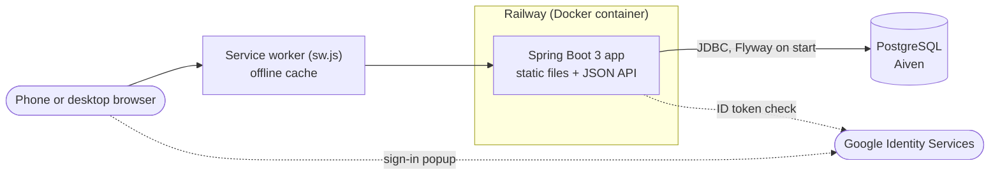
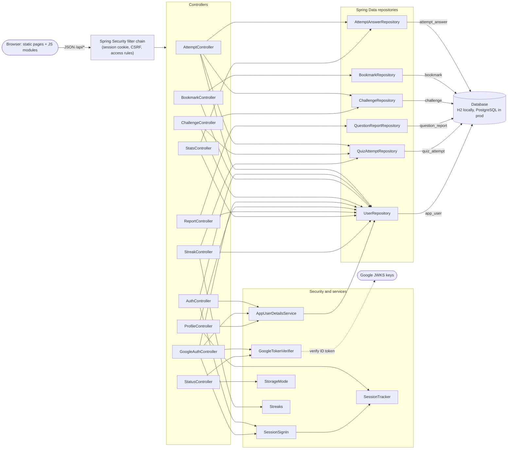
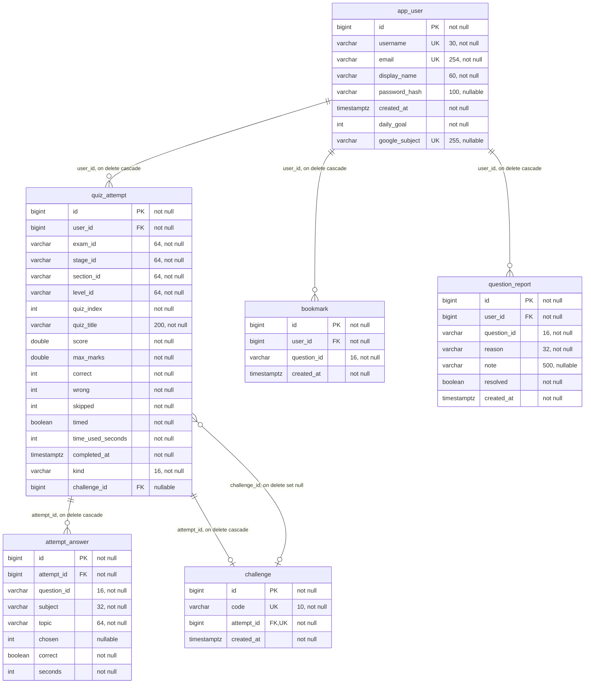
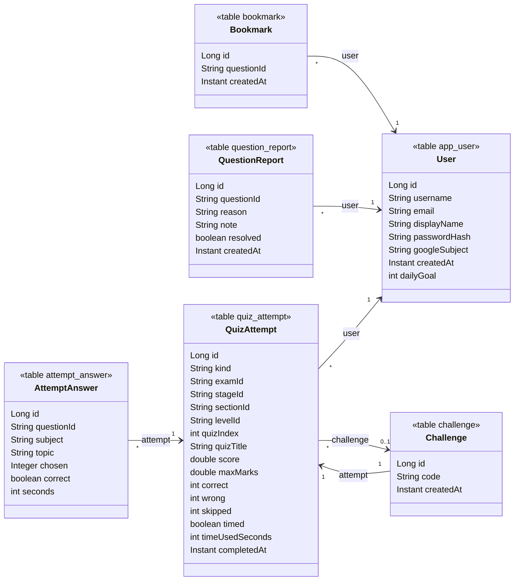
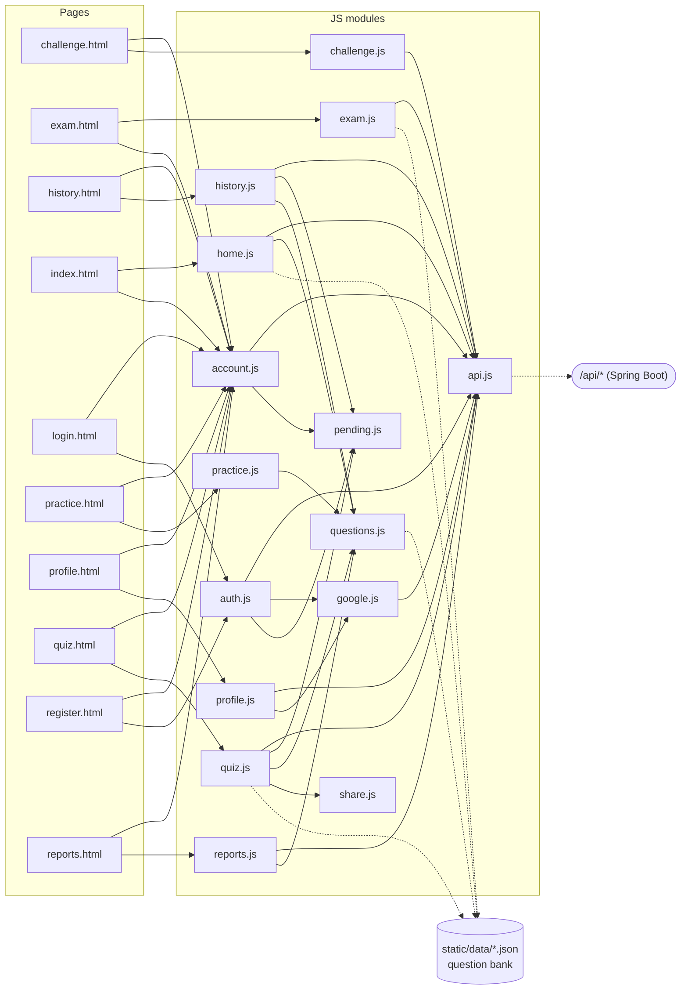
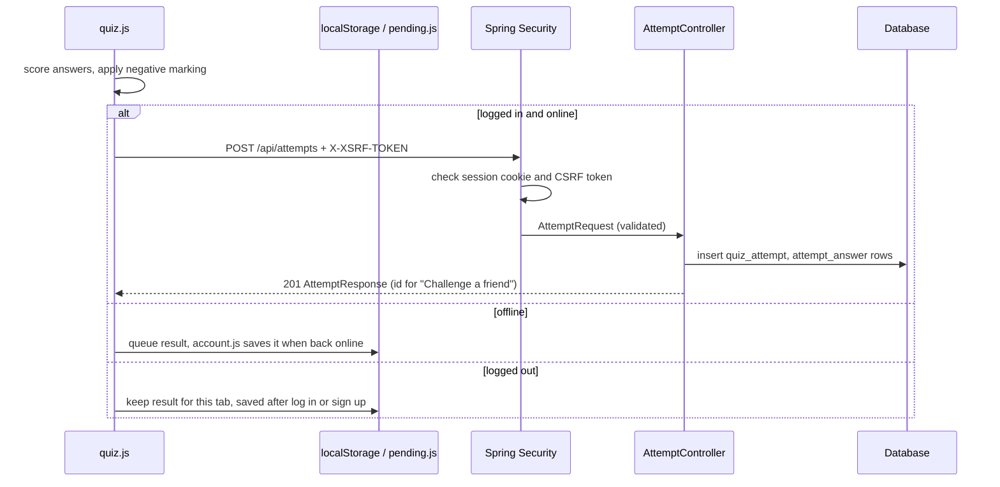
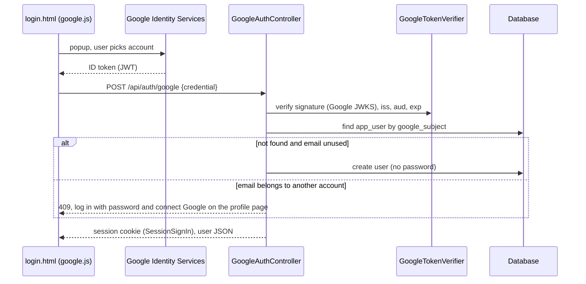
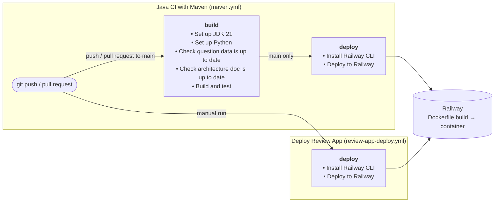
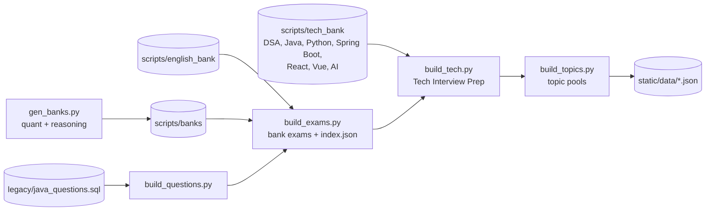

# QuizVerse Architecture

How the app is put together, from the browser to the database. The diagrams render on GitHub (Mermaid).

**Keeping this up to date:** everything between `BEGIN GENERATED` and `END GENERATED` markers is built from the code by `scripts/build_architecture.py`:

| Section | Built from |
|---|---|
| Backend components | controllers' and helpers' constructor parameters, repositories' entity types |
| Endpoints | `@*Mapping` annotations and their javadoc, access from the rules in `SecurityConfig` |
| Database schema | the Flyway migrations, replayed in order |
| JPA entities | `model/*.java` fields and `@ManyToOne` / `@OneToOne` relations |
| Frontend | each page's `<script>` tags and each module's imports and `fetch` calls |
| Configuration | `${ENV_VAR}` references in `application*.properties` |
| Build and deploy | `.github/workflows/*.yml` |
| Question content | `static/data/index.json` and the quiz files |

It updates three ways:

1. **Every commit (automatic).** Run `git config core.hooksPath .githooks` once per clone. The pre-commit hook regenerates the docs from the staged files whenever a commit touches anything above, and adds them to the commit.
2. **CI (safety net).** `build_architecture.py --check` fails the build if the docs don't match the code, so a commit made without the hook can't merge.
3. **By hand:** `python3 -I scripts/build_architecture.py`.

Edit only the text outside the markers; it explains what the code can't show. The README's schema diagram is generated the same way.

## The big picture

- **One deployable.** The Spring Boot jar serves the static site (`src/main/resources/static`) and the `/api` JSON endpoints. Railway builds it from the `Dockerfile` on every push to `main`.
- **Quizzes run in the browser.** Questions are static JSON files. `quiz.js` loads a quiz file, runs the timer, scores it and only then posts the result to `/api/attempts`. The server never sees questions or answer keys, so saved scores are self-reported.
- **Accounts and history live in the database.** Spring Security keeps the login in a server-side session (30-day cookie); CSRF uses the `XSRF-TOKEN` cookie echoed in a header by `api.js`.
- **Offline.** The service worker caches pages and every quiz file opened once. A result finished offline is queued in the browser (`pending.js`) and saved when the device is back online.
- **One instance.** Sessions are in memory, so the app must run as a single instance (see the roadmap before scaling out).

## Backend components

Controllers handle HTTP and validation, repositories (Spring Data JPA) talk to the database, and a few helpers sit in `security/` and `service/`. There is no separate service layer: controllers call repositories directly, each request in one transaction.

<!-- BEGIN GENERATED: components -->

<!-- END GENERATED: components -->

### Endpoints and who can call them

"Access" comes from the rules in `SecurityConfig`: *public* needs nothing, *login* needs a session, *role ADMIN* needs a username listed in `QUIZVERSE_ADMIN_USERNAMES`. Every request that changes data also needs the CSRF header.

<!-- BEGIN GENERATED: endpoints -->
| Method | Path | Access | Controller | What it does |
|---|---|---|---|---|
| GET | `/api/admin/reports` | role ADMIN | ReportController |  |
| POST | `/api/admin/reports/{id}/resolve` | role ADMIN | ReportController |  |
| GET | `/api/attempts` | login | AttemptController | Newest first. |
| POST | `/api/attempts` | login | AttemptController |  |
| GET | `/api/attempts/best` | login | AttemptController |  |
| GET | `/api/auth/csrf` | public | AuthController | Hands out the CSRF token; also sets the XSRF-TOKEN cookie if the page has none yet. |
| POST | `/api/auth/google` | public | GoogleAuthController |  |
| POST | `/api/auth/login` | public | AuthController |  |
| POST | `/api/auth/logout` | public | AuthController |  |
| POST | `/api/auth/register` | public | AuthController |  |
| POST | `/api/challenges/from-attempt/{attemptId}` | login | ChallengeController | Creates the challenge for one of your attempts, or returns the existing one (one code per attempt). |
| GET | `/api/challenges/{code}` | public | ChallengeController | Public, so a link opened by someone logged out still shows what they're being challenged to. |
| GET | `/api/me` | login | AuthController | The logged-in user, or 401 (the frontend uses this to decide what to show). |
| PUT | `/api/me` | login | ProfileController |  |
| DELETE | `/api/me` | login | ProfileController | Removes the user and, through ON DELETE CASCADE, their attempts, answers, bookmarks, reports and challenges. |
| GET | `/api/me/bookmarks` | login | BookmarkController | Newest first. |
| PUT | `/api/me/bookmarks/{questionId}` | login | BookmarkController |  |
| DELETE | `/api/me/bookmarks/{questionId}` | login | BookmarkController |  |
| PUT | `/api/me/goal` | login | StreakController |  |
| POST | `/api/me/google` | login | GoogleAuthController | Connects a Google account to the logged-in user, so they can sign in with either. |
| DELETE | `/api/me/google` | login | GoogleAuthController | Disconnects Google. |
| GET | `/api/me/mistakes` | login | StatsController | Questions last answered wrong or skipped, newest first. |
| POST | `/api/me/password` | login | ProfileController | Keeps this session logged in and logs out every other one, e.g. a phone someone else has. |
| GET | `/api/me/streak` | login | StreakController |  |
| GET | `/api/me/topics` | login | StatsController |  |
| POST | `/api/reports` | login | ReportController | A second report of the same question by the same user, while the first is open, is a no-op. |
| GET | `/api/status` | public | StatusController |  |
<!-- END GENERATED: endpoints -->

## Database schema

Flyway owns the schema (`src/main/resources/db/migration`) and Hibernate only validates it. Migrations must run on both H2 (local and tests) and PostgreSQL. Never edit one that has run; add `V<n>__name.sql`.

Questions are not in the database. `question_id` columns hold the question's content hash (`q` + 11 hex), which points into the static JSON. `attempt_answer` copies the subject and topic so stats keep working after a question is removed.

<!-- BEGIN GENERATED: schema -->

<!-- END GENERATED: schema -->

<!-- BEGIN GENERATED: schema-notes -->
Built from 6 migrations (V1__accounts_and_attempts.sql … V6__challenges.sql).

| Table | Unique together | Indexes |
|---|---|---|
| `app_user` | - | - |
| `quiz_attempt` | - | `idx_attempt_user` (user_id, completed_at); `idx_attempt_challenge` (challenge_id) |
| `attempt_answer` | - | `idx_answer_attempt` (attempt_id); `idx_answer_question` (question_id) |
| `bookmark` | (user_id, question_id) | - |
| `question_report` | - | `idx_report_open` (resolved, created_at) |
| `challenge` | - | - |
<!-- END GENERATED: schema-notes -->

### JPA entities

The same tables as Hibernate sees them. Relations are navigable only in the direction drawn (there are no collection fields), and deletes cascade in the database, not through JPA.

<!-- BEGIN GENERATED: entities -->

<!-- END GENERATED: entities -->

### What a quiz attempt row means

`quiz_attempt.kind` says what was taken, and decides how the other key columns are used:

| kind | exam_id | stage_id | section_id | level_id / quiz_index |
|---|---|---|---|---|
| `exam` | exam (e.g. `ibps-clerk`, `tech`) | stage | section (`java`, `dsa`, …) | level and quiz number |
| `mock` | exam | stage | `mock` | level and mock number |
| `daily` | `daily` | `practice` | the IST date `yyyy-mm-dd` | `practice` / 0 |
| `tech-daily` | `tech-daily` | `practice` | the IST date `yyyy-mm-dd` | `practice` / 0 |
| `revise`, `bookmarks`, `custom` | the kind | `practice` | `practice` | `practice` / 0 |

## Frontend

Plain HTML pages, each loading one or two ES modules. `api.js` wraps `fetch` for the JSON API (CSRF header, 401 handling); `questions.js` reads the static question data and picks the daily sets. `theme.js` (light/dark) is on every page and left out of the chart.

<!-- BEGIN GENERATED: frontend -->

<!-- END GENERATED: frontend -->

## Request flows

Two flows that touch most of the stack.

**Finishing a quiz** (scoring stays in the browser; the server stores the result):

**Signing in with Google:**

## Configuration

Environment variables the app reads. Real values live in Railway (or your shell), never in the repo.

<!-- BEGIN GENERATED: config -->
| Variable | Default | Used by | Profile |
|---|---|---|---|
| `PORT` | `8080` | `server.port` | all, prod |
| `QUIZVERSE_ADMIN_USERNAMES` | (none) | `quizverse.admin-usernames` | all |
| `GOOGLE_CLIENT_ID` | (none) | `quizverse.google-client-id` | all |
| `PGHOST` | (none) | `spring.datasource.url` | prod |
| `PGPORT` | `5432` | `spring.datasource.url` | prod |
| `PGDATABASE` | (none) | `spring.datasource.url` | prod |
| `PGSSLMODE` | `require` | `spring.datasource.url` | prod |
| `PGUSER` | (none) | `spring.datasource.username` | prod |
| `PGPASSWORD` | (none) | `spring.datasource.password` | prod |
<!-- END GENERATED: config -->

## Build, test and deploy

<!-- BEGIN GENERATED: pipeline -->

<!-- END GENERATED: pipeline -->

The Docker build compiles the jar in a JDK stage and runs it on a JRE image. Flyway migrates the database when the app starts.

## Question content

Question data is generated, never edited by hand. The scripts run in this order (CI checks the output is committed):

<!-- BEGIN GENERATED: content -->
| Exam / track | Stage | Sections | Quizzes | Questions |
|---|---|---|---|---|
| IBPS Clerk | Prelims | English Language, Numerical Ability, Reasoning Ability | 45 | 1500 |
| IBPS Clerk | Mains | Reasoning Ability, English Language, Quantitative Aptitude | 45 | 1800 |
| SBI Clerk | Prelims | English Language, Quantitative Aptitude, Reasoning Ability | 45 | 1500 |
| SBI Clerk | Mains | General English, Quantitative Aptitude, Reasoning Ability | 45 | 2100 |
| IBPS RRB Clerk | Prelims | Reasoning Ability, Numerical Ability | 30 | 1200 |
| IBPS RRB Clerk | Mains | Reasoning Ability, English Language, Numerical Ability | 45 | 1800 |
| Java Practice | Practice | Java | 9 | 142 |
| Tech Interview Prep | Practice | Data Structures & Algorithms, Java, Python, Spring Boot, React, Vue.js, Artificial Intelligence | 84 | 840 |

Quiz slots can reuse a question (the same bank feeds several exams): 3081 unique questions in 10 subjects.
<!-- END GENERATED: content -->

### Daily features

All three are picked in the browser from the IST date with a seeded random generator (`questions.js`), so everyone gets the same questions without any server work:

- **Daily quiz:** 10 bank-exam questions (4 quant, 3 reasoning, 3 English), 10 minutes. Saved as kind `daily`.
- **Daily tech challenge:** 5 questions from 5 of the 7 tech subjects, 5 minutes. Saved as kind `tech-daily`.
- **Question of the day:** one tech question answered on the home page, never one from today's tech challenge. The answer is kept in the browser for that day only; it isn't saved to the account.

`GET /api/me/streak` reports `dailyDone` and `techDailyDone`, and both count towards the day streak like any finished quiz.
